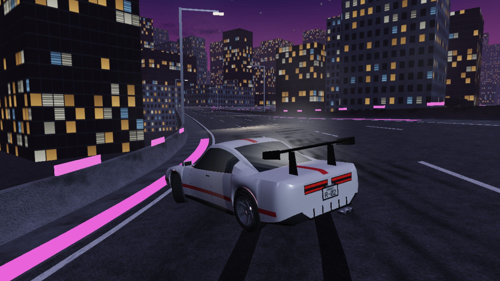

# x3d.drift: a racing game under the Loom

6 November 2026. **KANSEI** ([x3d.drift/](x3d.drift/)) is an original drift-racing game whose circuits, cars and showroom are X3D 4.0 files: five circuits, four cars, five modes (Drift Rush, Time Attack, Race, Tandem, Free Roam), a deterministic 120 Hz vehicle simulation with a race-line AI and a drift AI inside it, synthesised sound, and proof-of-play tapes for every circuit. It is the second game under the Loom after [NIB](PLATFORMER.md). This note records what was built, the numbers behind it, and what a racing game taught the Loom that a platformer did not.

## 1. What a racing game asks that a platformer does not

A platformer level is one player against fixed geometry. A racing circuit adds **other drivers**: three rivals on the grid, a lead car to chase in Tandem, contact between cars. A replay tape stores only the player's inputs. So the question a race asks is whether the whole field (every rival's line, every touch between cars, every overtake) is a pure function of the circuit bytes and the player's inputs. KANSEI answers it by putting the AI inside the sim: rivals are driven by `engine/ai.js`, which reads sim state only and is marked `// loom:sim`, so the portable-math rule binds it like the tyre model. A four-car race tape and a tandem tape now replay to the same final hash in Node and inside the shipped page at 200 and 37 ticks per frame.

A racing game also has a **handling** claim where a platformer has a jump-feel claim, and **medal targets** that are only fair if they come from a measured driver.

## 2. The contract

| Layer | Where | Rule |
|---|---|---|
| Circuit | `levels/*.x3d`, written by `x3d.drift/build/build_world.py` | X3D 4.0 Immersive; the sim reads only the `MetadataSet` `kansei:track` (a closed centreline every 2 m with bank, half-width, walls and grip; checkpoints, sectors, a 6-slot grid, clip zones, props, medal targets, runoff); road, kerbs, barriers and terrain are built from the same rounded samples; the build is byte-identical on rerun |
| Car | `cars/*.x3d` | `Transform DEF Car` with `Body`, `WheelFL..RR`, `SpinFL..RR`; hubs, wheel radius, track, wheelbase and CG height in a `MetadataSet` `kansei:car` |
| Sim | `engine/*.js` marked `// loom:sim` | fixed 120 Hz, no clock, no randomness, `engine/fmath.js` polynomials in place of `Math.sin`/`atan2`/`exp`/`pow`; tyres, drivetrain, assists, contact, scoring, both AIs; 64-bit state hash |
| Picture | `main.js`, `engine/render.js` and friends, X_ITE 16.5.1 | reads sim state, interpolates, never writes it |
| Proof | `tapes/*.tape.json`, `tests/fixtures/tapes/` | input bits per tick (run-length coded), bound to the level sha256 and `ENGINE_VERSION`, with the final state hash and the goal (valid lap, stated medal, or the finish line) |

## 3. Numbers (6 Nov)

| Measure | Value | Instrument |
|---|---|---|
| World | 5 circuits (377 m to 3193 m), 4 cars, a showroom, 69 textures; 10 X3D files; rebuild byte-identical (81 files) | `python3 -I build/build_world.py --check` |
| Validity | 10/10 XSD valid, 0 errors; semantic 0 errors, 0 warnings; 11 trap rules, 0 hits | x3d_mcp fork 327c5c4, `kit/loom traps` |
| Handling | every window holds for every car: 0–100 km/h 3.79–7.42 s, top speed 208.8–299.9 km/h, skidpad 0.99–1.08 g, wet 0.72–0.75 of dry, held drift 13.3–36.0 s; left/right symmetry within 0.03%, wheel-load sum error 4e-16 | `tests/handling.test.mjs` |
| Suite | track contract on every circuit (75 checks), keyboard-only drifting (9), scoring, race rules and determinism (34), AI on every circuit (70) | `node tests/run_all.mjs` |
| Proof of play | 18 tapes on 8 levels (12 on the 5 circuits: attack and rush each, plus a four-car race and a tandem; 6 on 3 test fixtures), each replayed twice to its recorded hash | `kit/loom play` |
| Render independence | the 12 circuit tapes × {200, 37} ticks per frame in the real page: same final hash as Node, 0 page errors | `tools/check_browser.cjs`, headless Chromium, software WebGL |

Never quote frame rates from these runs: the browser used software WebGL.

## 4. What the Loom gained

| # | Change | Why |
|---|---|---|
| 1 | **Profile `x3d-drift/v1`** (`kit/profiles/x3d-drift.json`) | grammar and meaning on 10 files, traps, page-traps, **handling**, **suite**, play (18 tapes, 8 levels) and behaviour required; eyes, fun, cross-engine and host visibly not run. The coverage numbers are pinned, so dropping a tape or a level rejects the receipt |
| 2 | **A handling card in place of a feel card** | A racing game's feel claim is a set of measured windows per car (acceleration, top speed, braking, grip, wet ratio, held drift) plus two invariants a model can break silently: left/right symmetry and conservation of wheel load. It runs through the existing `kit/loom command` adapter as the `handling` witness; no kit code was needed |
| 3 | **Race and tandem tapes** | A tape whose goal is the finish line of a race proves the AI field replays from the player's inputs alone. The page's witness mode and `tools/replay.mjs` share one goal rule per mode (valid lap, stated medal, finish) |

No kit code changed: the `command` adapter and `play` witness were general enough. The kit self-test (`python3 -I kit/tests/test_gates.py`, 56 negative controls) was rerun unchanged in normal and `-O` mode.

Two negative controls sit in the run folder, each made on a copy of the game:

- `control-engine-drift.json`: a Kessel Pass tape stamped with an older engine version, played by the current runner, fails with `PLAY_ENGINE_DRIFT` before it is replayed.
- `control-rival-skill.json`: the Salt Ring race tape with one rival's skill changed from 0.92 to 0.80 and every stamp left alone. The player's inputs are the same, the race still finishes, and the witness fails it with `PLAY_HASH_DRIFT` (`d2d86c019ed395ce` against `e1231725dffd7701`): the rivals are part of what the tape proves.

### The witnesses and the bots caught real things

- **The engine version moved three times, and the tapes noticed.** The third bump (`/4`) came from a review: a 12° wobble down a straight counted as a transition, so a weaving bot with no corner logic earned gold on Salt Ring; medals ignored the car, the tune and the surface; and the state hash skipped some AI fields. The fixes changed every hash, and every tape was re-recorded. The first two: The AI learned to pass and to link bends in Drift Rush (`kansei-engine/2`), then a reset stopped saving a drift chain (`/3`, below). No bot tape contains a reset, so every hash survived the second bump; the version moved anyway, because a person's tape with a reset in it would replay differently, and the rule is "any change that alters *a* replay". Every tape was re-recorded by the same bot and only its `engine` field changed.
- **Playing it in the browser found a scoring hole.** A scripted keyboard session on Neon Overpass showed a pending chain still on the HUD after pressing R. Reset teleported the car but left the chain to bank after its grace, so R was a way to save a chain from a crash. A reset now loses the chain like a wall does; `tests/race.test.mjs` has the check.
- **The bots were the first playtesters again.** The race AI could not pass: being held back by a slower car stopped it from "closing", so it never pulled out (it now decides from the speed it wants). Drift Rush scores on long circuits were tiny until the drift AI learned to keep a shallow slide between bends. Medal targets were then set from the bot's own runs with stated factors, not guessed.
- **The integration found a leak before it was committed.** `x3d.drift/vendor/x_ite` was a symlink into a session scratch folder and nothing ignored it; `x3d.drift/.gitignore` now does, as in x3d.platformer.

## 5. Candidate laws

1. **Simulate the rivals, prove the field.** When other drivers are part of the outcome, they run inside the deterministic sim, so the player's inputs alone replay the whole race; prove it with a race tape replayed in the browser.
2. **A version bump is owed to every replay, not only the recorded ones.** Bump the engine version for any rule change that some input could expose, even when no shipped tape changes hash.
3. **Targets are measurements.** Medal times and scores come from a named driver's measured runs with stated factors, and move when the driver or the circuit moves.

## 6. Open

- People playing it: fun, fairness, difficulty and the keyboard, pad and touch feel are not witnessed (`fun` is visibly not run). Audio has not been listened to.
- Replays in Firefox and Safari (SpiderMonkey, JavaScriptCore), and frame rates on real GPUs.
- Medal factors per car and for the wet are one number each, averaged over the circuits from the AI's runs, so on a single circuit a car or the wet can still be easier or harder than RONIN on the dry; the tandem chaser on the tape is a simple bot that grades D (a chase AI is the next AI to write).
- Run folder: [runs/drift-20261106/](runs/drift-20261106/) (receipt under `x3d-drift/v1`).
