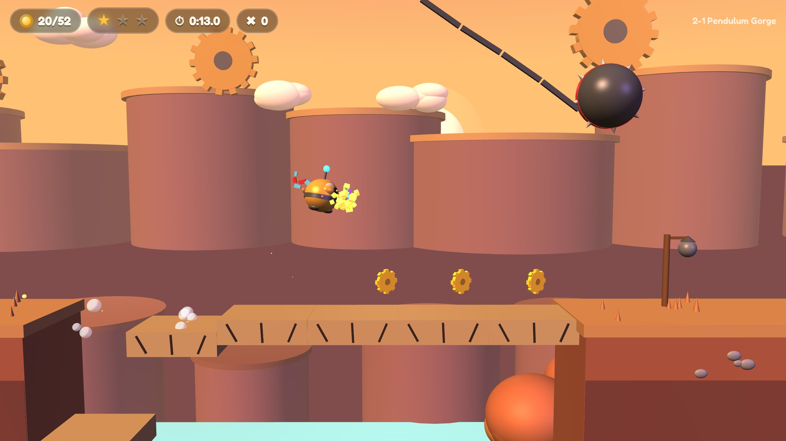

# x3d.platformer: a game under the Loom

6 November 2026. **NIB** ([x3d.platformer/](x3d.platformer/)) is an original, physics-heavy 2.5D platformer whose levels are X3D 4.0 files: three worlds plus a measurement level, a deterministic rigid-body engine, synthesised sound, and one proof-of-play tape per level. This note records what was built, the numbers behind it, and what a game taught the Loom.

## 1. What a game asks that a scene does not

A scene file claims "this is valid and this is what it looks like". A level claims more: **this can be played, and finished, and it plays the same for everyone.** Grammar, Meaning and Traps read the file; Behaviour shows it loads. None of them notices a level nobody can beat, a gap one centimetre wider than the longest jump, or an engine change that quietly makes yesterday's run fall into a pit. The game needed three things the Loom did not have: a witness for play, a rule for portable simulation code, and a feel card.

## 2. The contract

| Layer | Where | Rule |
|---|---|---|
| Level | `levels/*.x3d`, written by `build/build_levels.py` | valid X3D 4.0, Immersive profile plus RigidBodyPhysics level 2; colliders are `RigidBody`/`CollidableShape`, joints `SingleAxisHingeJoint`, lift paths `PositionInterpolator`; game roles in `MetadataSet` (`nib:level`, `nib:body`, `nib:entity`); the `RigidBodyCollection` is disabled so the browser never simulates it |
| Sim | `engine/*.js` marked `// loom:sim` | fixed 120 Hz tick, no clock, no randomness, no engine-approximated math (`dsin`/`dcos` polynomials); 64-bit state hash |
| Picture | `engine/render.js`, X_ITE 16.5.1 | reads sim state and interpolates; may use `Math.sin` and `Math.random`; can never change an outcome |
| Proof | `tapes/*.tape.json` | input bits per tick (run-length coded), bound to the level sha256 and `ENGINE_VERSION`, with the final state hash |

## 3. Numbers (6 Nov)

| Measure | Value | Instrument |
|---|---|---|
| Levels | 4 (0-0 Feel Lab, 1-1 Tinker Meadow, 2-1 Pendulum Gorge, 3-1 Clockwork Spire) | `build_levels.py --check`: rebuild byte-identical |
| Validity | 4/4 XSD valid, 0 errors; semantic 0 errors, 0 warnings | x3d_mcp fork 327c5c4 |
| Feel | 9/9 windows hold | `tests/feel.test.mjs`, Node 22.23.4 |
| Bot runs | 1-1: 42.9 s, 65/66 cogs, 3/3 gears, 0 deaths. 2-1: 34.4 s, 47/52, 3/3, 0. 3-1: 19.8 s, 34/34, 3/3, 0 | `tools/bot.mjs` |
| Determinism (Node) | each tape replayed twice, same hash, equal to the recorded one | `kit/loom play` |
| Determinism (browser) | 3 tapes × {200, 37} ticks per frame: same final hash as Node, 0 page errors | `tools/check_browser.cjs`, Chromium 153.0.8010.12, Playwright 1.63.0, software WebGL (SwiftShader) |
| Kit self-test | 56 negative controls caught with their intended code, 11 trap rules, 7 page-trap rules, 10 page forms, in normal and `-O` | `python3 -I kit/tests/test_gates.py` |

Never quote frame rates from these runs: the browser used software WebGL.

## 4. What the Loom gained

| # | Change | Why (the incident) |
|---|---|---|
| 1 | **`kit/loom traps` fixed** | It raised `NameError` on every call (`seen` was never defined), and an uncaught exception exited 1, the code for a contract violation. The self-test passed because it called `traps.check` directly, never the CLI. Now `seen` reports scenes and bytes read, and any unexpected exception exits 2 (instrument error, law 19). Two CLI-level controls guard both. |
| 2 | **`kit/loom play`, a proof-of-play witness** (`kit/loomkit/play.py`) | Runs the project's own headless replay runner on every tape, twice, and checks in order: `PLAY_LEVEL_STALE`, `PLAY_ENGINE_DRIFT`, `PLAY_NONDETERMINISTIC`, `PLAY_GOAL_NOT_REACHED`, `PLAY_HASH_DRIFT`, `PLAY_LEVEL_UNPROVEN`, `PLAY_LEVEL_MISSING`, `PLAY_NO_TAPES`. A crashing runner is exit 2. Ten controls on a synthetic toy game, including the trap a stamp alone would miss: the level is made harder and the tape is re-stamped with the new sha256, and the replay must still fail (`PLAY_GOAL_NOT_REACHED`). |
| 3 | **Page trap `sim-nonportable-math`** | ECMAScript leaves `Math.sin`, `cos`, `exp`, `pow`, `atan2` and `**` implementation-approximated, so a tape recorded in one JavaScript engine may diverge in another; clocks and `Math.random` differ on every run. The rule binds only files that declare `// loom:sim`, so render and audio code stay free. Two-sided, plus four forms (marker scope, `**` beside `/** */` and `*=`, randomness and clocks, inline HTML scripts). Spec fact; a cross-engine divergence was not reproduced here (L). |
| 4 | **Profile `x3d-game/v1`** and a **feel card** template | grammar, meaning, traps, page-traps, feel, play, behaviour required; eyes, fun, cross-engine and host visibly not run. `kit/templates/FEEL-CARD.md`; the filled card is `x3d.platformer/docs/FEEL-CARD.md`. |

### The witnesses caught real things

- **The validator caught the builder.** The first levels used `HingeJoint`, which is not an X3D node (the XSD said *"Element 'HingeJoint': This element is not expected"*). It is `SingleAxisHingeJoint`; generator and loader were fixed.
- **`loom play` caught an engine change.** Ring chains needed one rule change (a ring you just let go of cannot be re-grabbed for 0.5 s). The engine version went from `nib-engine/1` to `nib-engine/2`, and the next `loom play` on the old 1-1 tape failed with `PLAY_ENGINE_DRIFT` before any re-recording. The re-recorded 1-1 tape ends in the same state hash (`78653115e278cfc3`): world 1 has no rings.
- **The bots were the first playtesters.** A bot that must actually finish found: a star a full jump could not reach (moved), a spring whose collider blocked walking (springs became triggers), a lift whose boarding depended on arrival phase (the route now hops on as it descends; a player has the same problem), a crumbling step directly above another so the jump bonked its underside (the ladder now climbs one way), and a wall shaft whose exit was 0.5 m higher than the column beside it (levelled).

## 5. Candidate laws

1. **A playable world carries its proof of play.** Each level ships a replayable record, bound to its exact bytes and engine version, that reaches the finish; the witness replays it, it does not trust the stamp.
2. **The sim tick owns the game; the picture interpolates.** Outcomes are a pure function of level bytes and inputs; rendering reads state and never writes it. Test it by replaying at very different frame rates.
3. **A pass must cross the CLI.** A witness tested only through its library can be broken at the command line while the self-test stays green; test the command a person runs (exit codes included).

## 6. Open

- Replays in Firefox and Safari (SpiderMonkey, JavaScriptCore): the strongest test of law 2 and of rule 3, not run.
- People playing it: fun, fairness and difficulty curve are not witnessed (`fun` is visibly not run). Touch and gamepad feel untested.
- More worlds; per-level music; an in-browser level editor that writes X3D; a Blender round-trip of a level.
- Run folder: [runs/platformer-20261106/](runs/platformer-20261106/) (receipt under `x3d-game/v1`).
