# KANSEI: a drift-racing game made of X3D

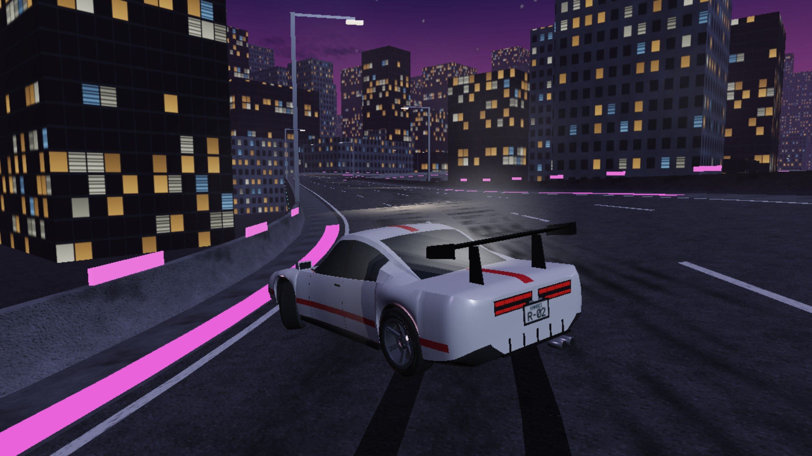

**KANSEI** (慣性, *inertia*) is a night-drift racing game for the browser. Four original cars, five circuits, five ways to play: chain slides through clip zones in a 90-second Drift Rush, chase clean laps against your own ghost, start from the back of a four-car grid, or follow a drifting lead car door to door in Tandem. Every circuit, every car and the showroom is a plain **X3D 4.0 file**. The same bytes are drawn by [X_ITE](https://create3000.github.io/x_ite/) and read by the game's own vehicle simulation, a deterministic 120 Hz tyre-and-drivetrain model (load transfer, tyre temperature, turbo lag, limited-slip diff, AWD split, assists), so the circuit file *is* the circuit. Every result is a replayable tape: the game re-simulates a run from its inputs and checks the final state hash, in Node and in the browser.

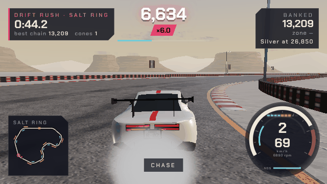

## Play

```bash
tools/fetch_xite.sh          # once: puts X_ITE 16.5.1 in vendor/ (otherwise the page loads it from a CDN)
python3 -m http.server 8000  # then open http://localhost:8000/
```

| Action | Keyboard | Gamepad (standard) | Touch |
|---|---|---|---|
| Throttle / brake (reverse when stopped) | W / S or ↑ / ↓ | RT / LT | GAS / BRK |
| Steer | A / D or ← / → | left stick, d-pad | ◀ ▶ |
| Handbrake (tap to flick, hold to slow) | Space | A | HAND |
| Boost (finite, refilled by drifting) | Shift | B | NOS |
| Shift down / up (manual box) | Q / E | LB / RB | |
| Camera: chase, close, bumper, hood, orbit, director | C | Y | CAM |
| Photo mode | F | | pause sheet |
| Pause | Esc or P | Start | ❚❚ |
| Reset to the road, never onto another car (voids the lap in Time Attack and Race, loses the chain) | R | | |
| Telemetry overlay (tyre loads, temps, slip, grip) | F2 | Back | |
| Sound on / off | M | | |

**First drift:** get to 50–70 km/h, steer in and tap Space. Stay on the gas and let the car swing, then steer the other way to hold the angle. Lift to tighten the line, add gas to swing wider. A long chain grows its multiplier every 2 s up to ×6, switching the slide from one bend into the next adds +1 (each side a real slide: past 20° while the car turns; a wobble down a straight does not count), and running a rear wheel close to a marked edge is a CLIP (×2) or a PERFECT (×3). A wall or a reset loses the chain; two seconds of grip banks it.

## Modes

| | Mode | Goal |
|---|---|---|
| 一撃 | **Drift Rush** | 90 s from the first roll. Points per tick from angle × speed × multiplier × zone; bronze, silver, gold, platinum per circuit |
| 計時 | **Time Attack** | Clean laps (1, 3, 5 or ∞): checkpoints in order, three sectors with split deltas, a lap is void after a second off the road or a reset. Your best lap in the same car and surface replays as a ghost (switchable) |
| 競走 | **Race** | You and three AI rivals of different skill, three-light start, car-to-car contact, positions, overtakes |
| 追走 | **Tandem** | An AI lead drifts the circuit; you chase. Scored every tick on distance (best 1.5–4 m), angle match and line match, minus contact. Grades D to S |
| 自由 | **Free Roam** | No clock: practise, find lines, take photos |

Stars from medals, positions and grades unlock the fourth car (12 stars) and fill the career grid. The setup screen has surface (dry or wet with rain), laps, rival skill, ghost on or off, quality, start camera, the tune sliders and the assists, and shows the medal targets for exactly that car, grip tune and surface. Records and best tapes are kept per circuit, mode, car and surface. Results show the run hash; **Replay** re-simulates the run from its tape (scrub, ¼× to 2×, free cameras) and marks it verified when the hash matches, and **Tape** gives you the run as JSON.

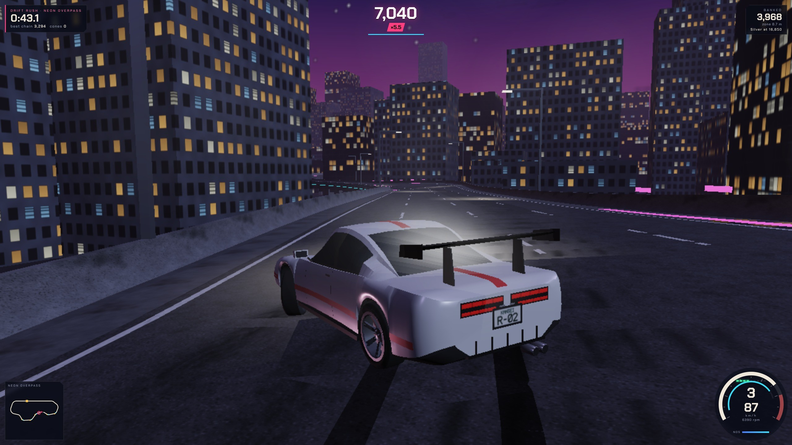

## Cars

| Car | Layout | Power / torque / mass | 0–100 km/h | Top speed | Skidpad | Character |
|---|---|---|---|---|---|---|
| **KOI** | FR, naturally aspirated I4 | 210 hp · 230 N·m · 1020 kg | 7.42 s | 208.8 km/h | 0.99 g | light, flickable, honest: the car that teaches you to drift |
| **RONIN** | FR, turbocharged I6 | 380 hp · 470 N·m · 1290 kg | 5.38 s | 252.9 km/h | 1.01 g | the default: balanced, with turbo lag to time |
| **TEMPEST** | AWD, twin-turbo V6 | 520 hp · 620 N·m · 1480 kg | 3.79 s | 266.4 km/h | 1.08 g | grip monster: fastest lap, hardest to slide |
| **BANSHEE** | FR, naturally aspirated V8 | 690 hp · 780 N·m · 1420 kg | 4.49 s | 299.9 km/h | 1.01 g | pro drift weapon, unlocked by stars |

Measured by `tests/handling.test.mjs` (0–100 with launch control; skidpad on a 60 m circle; wet grip is 0.72–0.75 of dry). The full card, with braking, held-drift times and how each number is taken, is [docs/HANDLING-CARD.md](docs/HANDLING-CARD.md). Each car has six liveries and its own synthesised engine note.

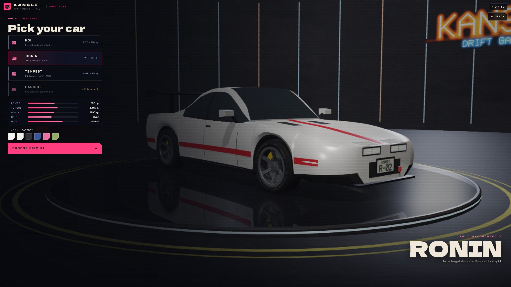

## Circuits

| | Circuit | Length | What it asks | Gold lap · rush gold |
|---|---|---|---|---|
|  | **Kessel Pass**, mountain touge at sunset | 2203.5 m | 40 m of climb, two hairpins, esses between guardrails | 80.3 s · 8850 |
| 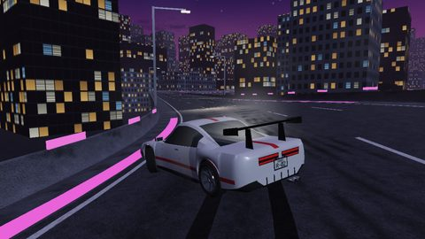 | **Neon Overpass**, night city | 2562.3 m | banked elevated loops, a tunnel, LED edge lines, headlights | 78.8 s · 23850 |
| 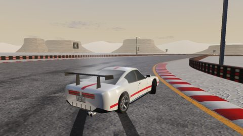 | **Salt Ring**, drift arena at golden hour | 1218.0 m | 26 m wide, 16 clip zones, 80 cones that fly | 49.8 s · 30300 |
| 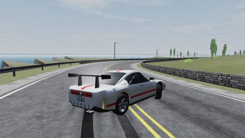 | **Cliffside Esses**, coast road at noon | 3193.4 m | fast esses over the sea, stone walls, gravel runoff | 86.6 s · 9500 |
| 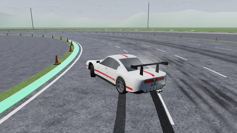 | **Practice Pad**, skidpad | 377.0 m | a 60 m circle and 96 cones for learning to hold angle | 14.6 s · 70000 |

Medal targets come from the game's own AI on each circuit, for a stock RONIN on the dry (gold is 2% slower than its best lap; rush gold is 85% of its score); the Practice Pad's rush tiers come from a scripted keyboard driver instead, because the AI's near-perfect circle is out of a person's reach. Each run's targets are scaled for the car, the wet and the grip tune by the pace the AI measured, so KOI, TEMPEST, BANSHEE, wet runs and a 1.2× grip tune all ask for the same drive. Scripted drivers that wobble, spin, weave or lean on a wall earn no medal (`tests/exploits.test.mjs`).

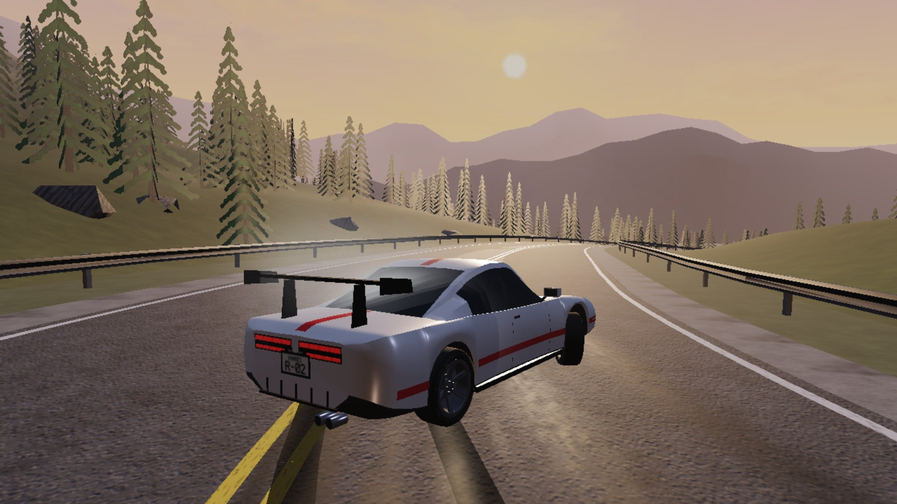

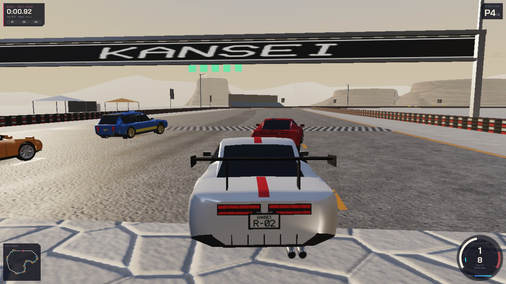

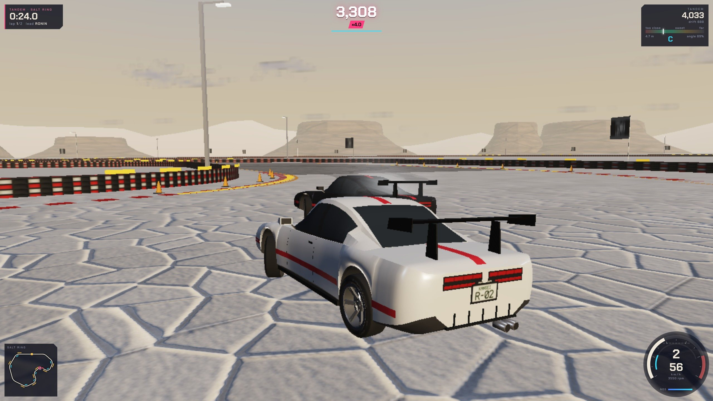

## How it works

| Layer | Where | Rule |
|---|---|---|
| World | `levels/*.x3d`, `cars/*.x3d`, `garage.x3d`, `textures/`, all written by `build/build_world.py` | X3D 4.0, Immersive profile; each circuit carries its centreline (x y z, bank, half-width, walls, grip every 2 m), checkpoints, sectors, grid, clip zones, props and medal targets in a `MetadataSet` named `kansei:track`; the road, kerbs, barriers and terrain are built from the same samples. Rebuilds byte for byte |
| Sim | `engine/*.js` marked `// loom:sim` | fixed 120 Hz tick, no clock, no randomness, no engine-approximated math (`engine/fmath.js` polynomials); four tyres with combined slip, load sensitivity and temperature; drivetrain, assists, car contact; five modes with scoring; a race-line AI and a drift AI that run inside the sim; a 64-bit state hash |
| Picture | `main.js`, `engine/render.js`, `camera.js`, `fx.js`, `audio.js`, `ui.js` | reads sim state through X_ITE's SAI and interpolates; tyre smoke, skid marks, sparks, backfire, rain, headlights, camera shake, synthesised engine and turbo sound. It can never change an outcome |
| Proof | `tapes/*.tape.json`, `tests/fixtures/tapes/` | input bits per tick (run-length coded), bound to the level's sha256 and `ENGINE_VERSION`, with the final state hash |

The circuit ships with its proof: a tape per mode recorded by the game's own AI driving the player's car, replayed by `tools/replay.mjs` in Node and by `tools/check_browser.cjs` inside the real page at two very different frame rates. A change to the engine that alters any replay must bump `ENGINE_VERSION`; a stale tape is caught by the [Loom](../LOOM-v1.md) `play` witness before anyone looks at a picture. The contract every builder worked to is [docs/CONTRACT.md](docs/CONTRACT.md).

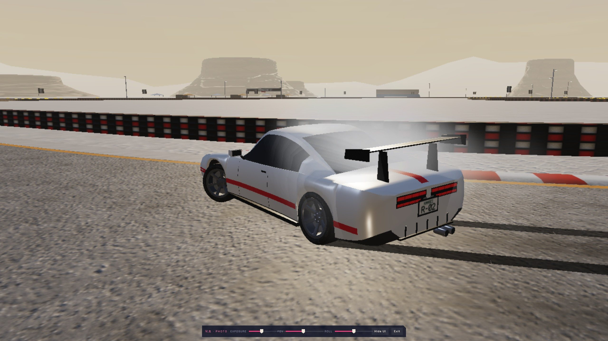

## Proof

| Claim | Command (from `x3d.drift/` unless noted) | Result (6 Nov) |
|---|---|---|
| The world rebuilds byte for byte | `python3 -I build/build_world.py --check` | `rebuild_identical: true`, 81 files |
| Every fast check and every tape | `node tests/run_all.mjs` | pass: portable math 14/14, track contract 80/80, handling card, keyboard-only drifting 9/9, scoring and race rules 40/40, AI on every circuit 70/70, adversarial scoring 32/32, 18 tapes replay to their hash |
| The handling card holds | `node tests/handling.test.mjs` | every window, every car; left/right symmetry within 0.03%; wheel-load sum error 4e-16 |
| Each tape replays deterministically to its finish | `node tools/replay.mjs tapes/<id>-<mode>.tape.json` | 12 circuit tapes and 6 fixture tapes: state `won`, hash equal to the recorded one, level sha256 and engine `kansei-engine/4` match |
| The page reaches the same state as Node | `node tools/check_browser.cjs` | 12 circuit tapes (attack, rush, a four-car race, a tandem) × 200 and 37 ticks per frame: 24/24 runs with the Node hash, 0 page errors (headless Chromium, software WebGL) |
| The X3D is valid and meaningful | `kit/loom grammar x3d.drift --files 'levels/*.x3d,cars/*.x3d,garage.x3d'` (from the repo root) | 10/10 files XSD-valid, 0 semantic errors, 0 warnings |
| No known scene or page trap | `kit/loom traps …` and `kit/loom pagetraps x3d.drift --files 'engine/*.js,main.js,index.html'` | 11 rules, 0 hits; 7 rules on 18 files, 0 hits (the ten `// loom:sim` files use no engine-approximated math) |
| Proof of play | `kit/loom play x3d.drift --tapes 'tapes/*.tape.json,tests/fixtures/tapes/*.tape.json' --levels … --runner tools/replay.mjs` | pass: 18 tapes on 8 levels, each replayed twice |
| All of it at once | `kit/loom receipt … --profile kit/profiles/x3d-drift.json` | accepted under `x3d-drift/v1`; eyes, fun, cross-engine and host visibly not run |

Medal targets per circuit, lap times per car and how the AI behaves on each circuit are in [docs/HANDLING-CARD.md](docs/HANDLING-CARD.md). Bot tapes: `node tools/bot.mjs levels/<id>.x3d` (attack and rush), `--mode race --laps 2`, `--mode tandem`.

The Loom checks all of this as the profile `kit/profiles/x3d-drift.json`; the run folder is [runs/drift-20261106/](../runs/drift-20261106/), and [DRIFT.md](../DRIFT.md) says what a racing game taught the Loom.

The stills and the clip above were rendered by `tools/shots.cjs` from the tapes, in headless Chromium with software WebGL, at the **Low** quality setting (no shadows, fewer smoke puffs; the 3D drawn at 1280×720 inside a 2560×1440 page). Medium and High add sun shadows, headlight spots and denser smoke; they were too slow to capture on this machine.

**What is not shown:** nobody has played it yet, so fun, difficulty and how the cars feel on a real keyboard, pad or phone are untested by people (scripted keyboard drivers and the AI are the only drivers so far); frame rates were never measured (software WebGL only); the sound was never listened to; replays were not run in Firefox or Safari; the tandem chaser on the tape is a simple bot that grades D; the per-car and wet medal factors are one number per car and surface, averaged over the circuits from the AI's runs, so on a given circuit a car or the wet can still be somewhat easier or harder than RONIN on the dry.

## Layout

```
index.html, main.js        the page: menus over the showroom, HUD, input, session loop, replays
engine/                    sim (// loom:sim) and picture modules
levels/ cars/ garage.x3d   the X3D world (generated), textures/ its PNGs
build/                     build_world.py and its modules (python3 -I build/build_world.py [--check])
tapes/                     proof-of-play tapes for the shipped circuits
tests/                     run_all.mjs and the suites; fixtures/ with their own tapes
tools/                     bot.mjs (records tapes), replay.mjs (Loom runner), check_browser.cjs, shots.cjs, world_stills.cjs
docs/                      CONTRACT.md, HANDLING-CARD.md, media/
```

All cars, circuits, names, liveries and sounds are original and fictional.
