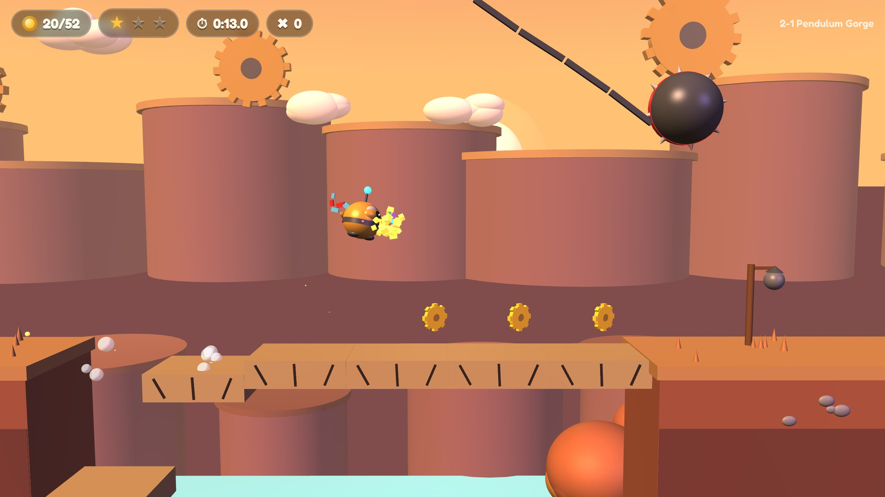
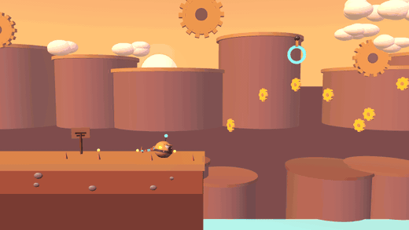
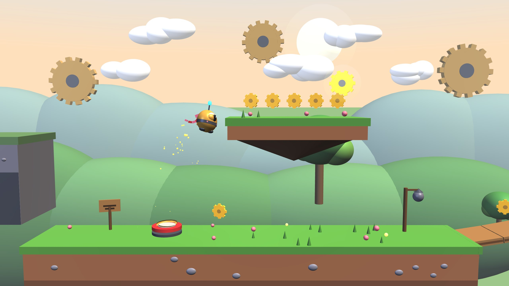
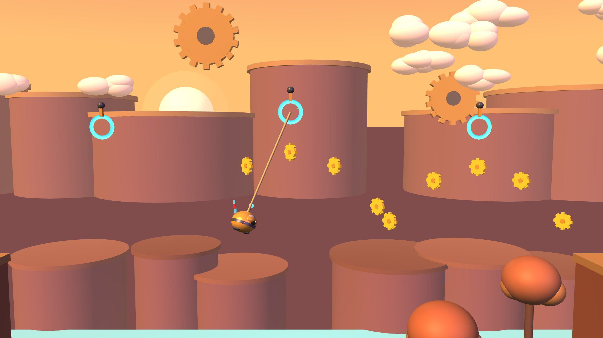
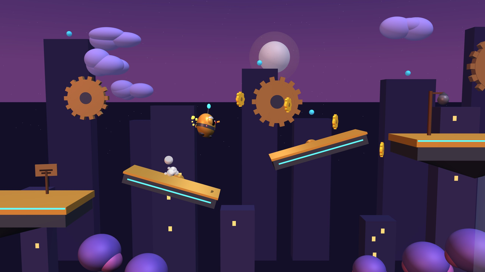
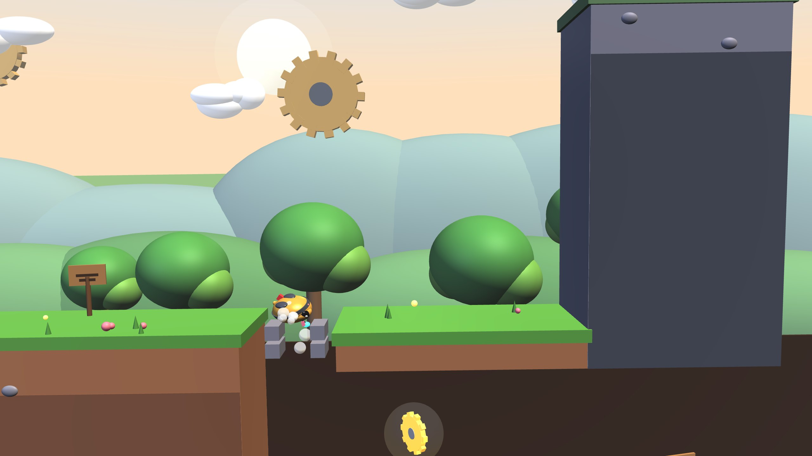
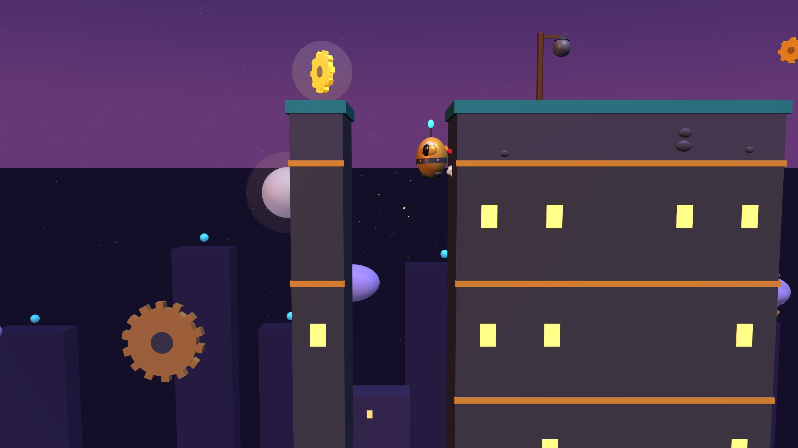

# NIB: a physics platformer made of X3D



Nib is a little clockwork robot with a wind-up key and a red scarf, out to collect every golden cog. Run, jump, wall-jump, ground-pound, hook onto glowing rings and swing, ride lifts and fans, and push crates, seesaws and boulders around a world where everything is a real rigid body.

Every level is a plain **X3D 4.0 file**. The same bytes are drawn by [X_ITE](https://create3000.github.io/x_ite/) in the browser and read by the game's own physics engine, so the scene file *is* the level: its `RigidBody` nodes are the colliders, its `SingleAxisHingeJoint`s are the bridges and pendulums, its `PositionInterpolator`s are the lift paths.



## Play

```bash
tools/fetch_xite.sh          # once: puts X_ITE 16.5.1 in vendor/ (otherwise the page loads it from a CDN)
python3 -m http.server 8000  # then open http://localhost:8000/
```

| Action | Keyboard | Gamepad | Touch |
|---|---|---|---|
| Run | ← → or A D | stick / d-pad | ◀ ▶ |
| Jump (hold for higher) | Space, Z or K | A (bottom) | ▲ |
| Wall jump | jump while sliding down a wall | | |
| Ground pound (breaks cracked stone, super-bounces springs) | ↓ or S in the air | ↓ or B (right) | ▼ |
| Hook a ring (hold), let go with jump | Shift, X, J or L | X (left), RB or RT | ⚓ |
| Pause, restart, sound | P or Esc, R, M | Start | ⏸ |

While hooked, ↑ and ↓ reel the rope in and out, and left and right pump the swing.

Each level has 3 golden gears to find, a pile of cogs, checkpoints, a par time and a rank (S, A, B, C). Best runs are kept in your browser, and the win screen can save your run as a replay tape. The **Lite** toggle on the world select lowers geometry quality for slow machines.

## Worlds

| | World | What it teaches | Bot run |
|---|---|---|---|
|  | **1-1 Tinker Meadow** | run, jump, push a crate to climb, springs, a hanging bridge, ground-pound into a cave, a seesaw catapult, a wall-jump chimney | 42.9 s · 65/66 cogs · 3/3 gears · 0 deaths |
|  | **2-1 Pendulum Gorge** | hook and swing, ride a lift across a canyon, cross a crumbling bridge under a wrecking ball, chain three rings, one ring over spikes, a cliff lift | 34.4 s · 47/52 cogs · 3/3 gears · 0 deaths |
|  | **3-1 Clockwork Spire** | ride a fan up, hop two turning gear-arms in rhythm, a crumbling ladder, a wall-jump shaft, a last ring to the top | 19.8 s · 34/34 cogs · 3/3 gears · 0 deaths |




## How it works

- **One file, two readers.** `build/build_levels.py` (Python standard library, byte-for-byte reproducible) writes `levels/*.x3d`. Game roles ride along as standard `MetadataSet` nodes (`nib:level`, `nib:body`, `nib:entity`), so a level stays valid X3D that any X3D browser can open. The `RigidBodyCollection` is disabled, so X_ITE draws the visuals and never simulates the colliders itself.
- **A deterministic engine.** `engine/physics.js` is a small 2D rigid-body solver (box and circle contacts with clipping, warm-started sequential impulses, revolute and rope joints, kinematic movers and spinners) stepped at a fixed 120 Hz. It uses its own polynomial sine and cosine, because JavaScript engines are allowed to disagree in the last bit of `Math.sin`.
- **The sim tick owns the game; the picture interpolates.** `engine/render.js` only reads the sim state and blends between ticks, so the frame rate can never change what happens. Camera, squash and stretch, scarf, dust, sparks, confetti, screen shake and hitstop all live on the picture side.
- **Feel is measured.** `engine/feel.js` holds every tuning number and the window each measured quantity must land in; `tests/feel.test.mjs` drives Nib in the Feel Lab level (`0-0`) and checks nine of them ([feel card](docs/FEEL-CARD.md)).
- **Every level carries its proof of play.** `tools/bot.mjs` plays a level with a closed-loop route (`tools/routes.mjs`) and records the run as a tape: one input byte per tick, bound to the level's sha256 and the engine version, with the final state hash it produced (`tapes/`). Anyone can replay a tape and check the hash.
- **Sound** is synthesised with WebAudio (no audio files): a little sequencer per world and juicy effects.

## Proof

| Check | Command | Result (6 Nov 2026) |
|---|---|---|
| Levels rebuild byte-identical | `python3 -I build/build_levels.py --check` | identical |
| Every level valid X3D 4.0 | x3d_mcp fork validator at 327c5c4 | 4/4: XSD 0 errors; semantic 0 errors, 0 warnings |
| Feel card | `node tests/feel.test.mjs` | 9/9 windows hold |
| Tapes replay to their recorded finish (Node 22.23.4) | `node tests/run_all.mjs` | 3/3, same hash twice each |
| Same finish in the real page | `node tools/check_browser.cjs` (Chromium 153.0.8010.12, X_ITE 16.5.1, software WebGL) | 3/3 tapes at 200 and at 37 ticks per frame, hash equal to Node, 0 page errors |

| Tape | Level sha256 | Ticks | Goal tick | Final state hash |
|---|---|---|---|---|
| 1-1 Tinker Meadow | `979542fde819…` | 5154 | 5034 | `78653115e278cfc3` |
| 2-1 Pendulum Gorge | `5c15c1abd2fa…` | 4126 | 4006 | `f2a7a49770611e45` |
| 3-1 Clockwork Spire | `6844f58f418a…` | 2376 | 2256 | `4fdab334d2fa7441` |

What is not shown: that it is fun (only people playing can say), replays in Firefox or Safari (other JavaScript engines; not run), touch and gamepad feel, real GPUs and frame rate. The tapes were played by bots, so each proves one way through a level, not that the level is fair.

The [Loom](../LOOM-v1.md) checks all of this as a profile, `kit/profiles/x3d-game.json`, with the new `loom play` witness; see [PLATFORMER.md](../PLATFORMER.md) for what the game taught the Loom.

## Files

| Path | What |
|---|---|
| `index.html`, `main.js` | the page: menus, HUD, input, fixed-step loop, replay and capture modes |
| `engine/` | `physics.js`, `game.js`, `x3d.js`, `feel.js`, `tape.js` (all marked `// loom:sim`), `render.js`, `audio.js` |
| `build/` | the level generator |
| `levels/` | the generated X3D levels and `MANIFEST.json` |
| `tapes/` | one proof-of-play tape per level |
| `tools/` | bots and routes, headless replay, browser gate, stills and clips |
| `tests/` | feel card and the fast checks |

Original game: characters, levels, art and sound are made for this project.
